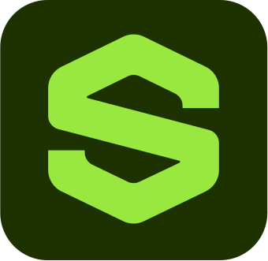
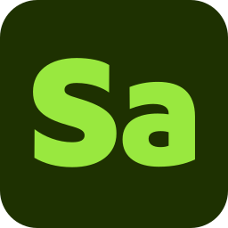
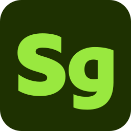
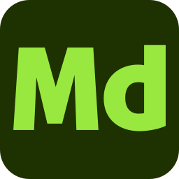
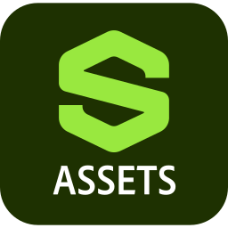
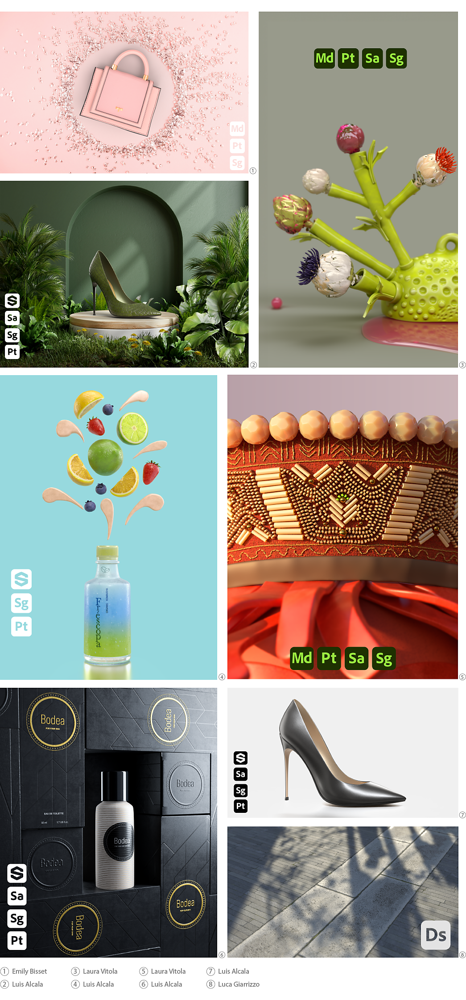

# アーティストのSubstance 3Dアイコン

<table>
  <tr style="border: 0;">
    <td style="border: 0;" valign="top"></td>
    <td style="border: 0;" valign="top"></td>
    <td style="border: 0;" valign="top"></td>
    <td style="border: 0;" valign="top"></td>
    <td style="border: 0;" valign="top"></td>
    <td style="border: 0;" valign="top"></td>
    <td style="border: 0;" valign="top"></td>
  </tr>
</table>

公開されたアートワークにSubstance 3Dアプリケーションのアイコンを含める場合は、以下からダウンロードできます。 画像はSVGフォーマットを使用しているため、あらゆるスケールで使用できます。

[カラー版、白黒版のSubstance 3Dアプリケーションアイコンが入ったzipフォルダーをダウンロードします。](../../assets/substance3d-icons.zip)

## Creative Cloudライブラリ

Creative Cloudユーザーは、この共有ライブラリからCreative Cloudアプリケーションの次のアイコンにアクセスできます。

[Substance 3Dアイコン](https://www.adobe.com/files/libraries/urn:aaid:sc:EU:0e944904-0efe-427f-8547-92744a19eeaf)

## 例

