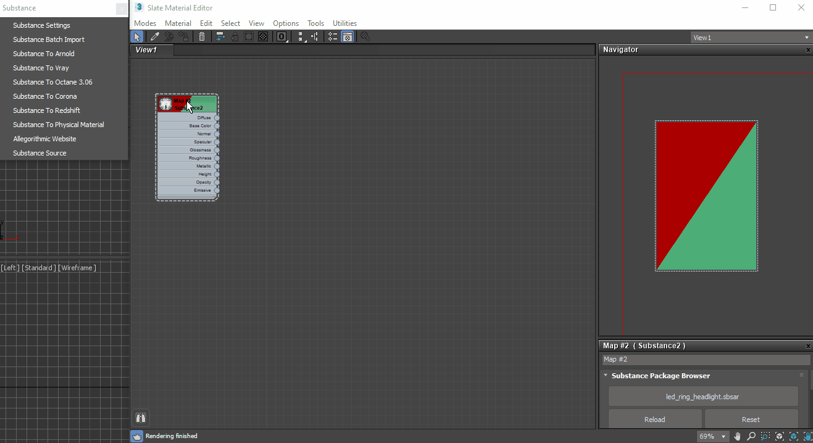

# 3ds Maxでのワークフローの使用

3ds MaxプラグインのSubstanceには、レンダラーをサポートするシェーダーネットワークを自動作成するためのワークフローが含まれています。 レンダリングワークフローは、Substanceメニューにあります。

ワークフローを使用するには、ワークフローエディターでSubstanceノードを選択し、マテリアルメニューからSubstanceを選択します。

