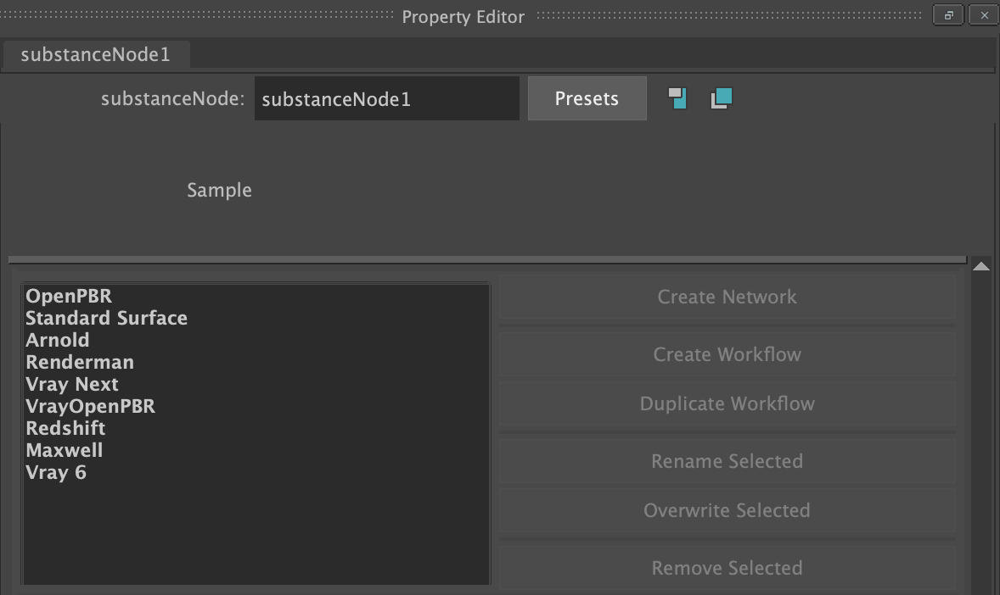
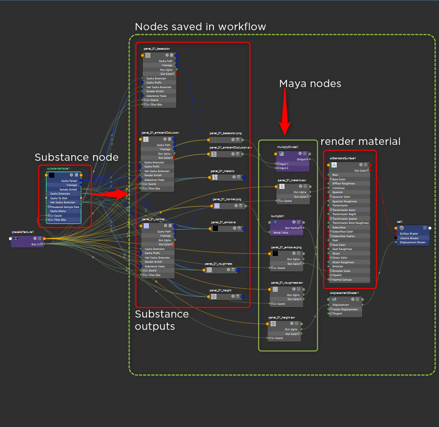

# ワークフローの使用

「ワークフロー」では、Substance出力のレンダリングプリセットを選択または作成できます。 これらのプリセットは、ArnoldやVrayなどのレンダラーのシェーダーネットワークです。

>[!NOTE]
>
> **ワークフロープリセットの場所**
>
> **Windows**:
> C:\Users\\Documents\maya\2022\substance\workflows\generated
> **MacOS**:
> /Users//Library/Preferences/Autodesk/maya//substance/workflows/generated
> **Linux**:
> /home//maya//substance/workflows/generated

ワークフローを使用するには、リストからプリセットを選択し、「ネットワークを作成」ボタンをクリックします。

## ワークフローの作成

独自のワークフローを作成して、[レンダラーのワークフロー]リストに追加できます。 新しいワークフローを追加すると、Substanceノードの後に作成されたノードがワークフローに保存されます。 これにより、任意の数のシェーディングノードを作成して、プリセットワークフローとして保存できる完全なカスタムシェーダーネットワークを構築できます。

## ワークフローの管理

### カスタムワークフローの保存

1. Substance出力を手動で作成し、aiStandardSurfaceなどのマテリアルに接続します。
   1. 任意のMayaノードまたはレンダー固有のノードを使用して、シェーダーネットワークを構築できます。
1. 「**ワークフローを作成**」ボタンをクリックして、ワークフロープリセットの名前を入力します。

### ワークフローの複製

「**ワークフローの複製**」ボタンをクリックすると、ワークフローを複製できます。

### ワークフローの名前の変更と上書き

選択した&#x200B;**名前の変更**&#x200B;および&#x200B;**上書き**&#x200B;ボタンを使用して、既存のワークフローの名前を変更したり、更新されたデータでワークフローを上書きしたりできます。

### ワークフローの削除

既存のワークフローを削除するには、「ワークフローを削除」ボタンを使用します。

## OpenPBRワークフロー

ワークフローの一覧では、次の2つのOpenPBRワークフローを使用できます： **OpenPBR**&#x200B;および&#x200B;**OpenPBR - V-Ray**。 これらのワークフローは、Substance 3D DesignerまたはSamplerのOpenPBRマテリアルモデルを使用して作成されたSBSARファイルで使用するように設計されています（OpenPBRは、Designer V16.0以降およびSampler V6.0以降のデフォルトのモデルです）。

### OpenPBRとは

OpenPBRは、Adobeとオートデスクが開発したオープンで物理的なマテリアルシェーディングモデルであり、Academy Software Foundation(ASWF)に寄稿されています。 レンダラ間で互換性のある統合されたマテリアル定義を提供します。 詳細については、[OpenPBRドキュメント](https://experienceleague.adobe.com/en/docs/substance-3d/general-knowledge/openpbr/openpbr-overview)を参照してください。

### OpenPBRワークフローを使用するタイミング

Substance 3D DesignerまたはSubstance 3D SamplerのOpenPBRワークフローを使用してSbsar ファイルを作成した場合は、OpenPBRマテリアルモデルを使用します。 SBSARがAdobe標準マテリアルモデル(ASM)を使用して作成された場合は、レンダラーと互換性のある従来のワークフロー（Arnold、V-RayまたはV-Ray 6）を使用します。

>[!NOTE]
>
> OpenPBRワークフローをASM マテリアルに適用する場合、または標準ワークフローをOpenPBR SBSARに適用する場合、プラグインは両方のマテリアルモデルに共通する出力のみを接続します。 結果が不完全になる場合があります。

### 使用可能なOpenPBRワークフロー

**OpenPBR**

ネイティブのMaya openPBRSurfaceノードを使用します。 ArnoldおよびV-Rayに対応しています。 これは、MayaでOpenPBR マテリアルを使用するほとんどのユーザに推奨されるワークフローです。

**OpenPBR - V線**

OpenPBRモードでV線マテリアル(VRayMtl)を使用します。 パイプラインがV線マテリアル設定を中心に構築されている場合にお勧めします。

### OpenPBRワークフローの適用方法

1. Substanceの読み込みボタンを使用して、プラグインにSbsar ファイルを読み込みます。
1. [ワークフロー]リストで、**OpenPBR**&#x200B;または&#x200B;**OpenPBR - V-Ray**&#x200B;を選択します。
1. **[ネットワークの作成]**&#x200B;をクリックして、**ハイパーシェードマテリアルエディタ**&#x200B;でシェーダーネットワークを作成します。
1. プラグインは、SBSAR出力をOpenPBRノードの対応する入力に自動的に接続します。
1. 通常どおり、マテリアルをメッシュに割り当てます。

